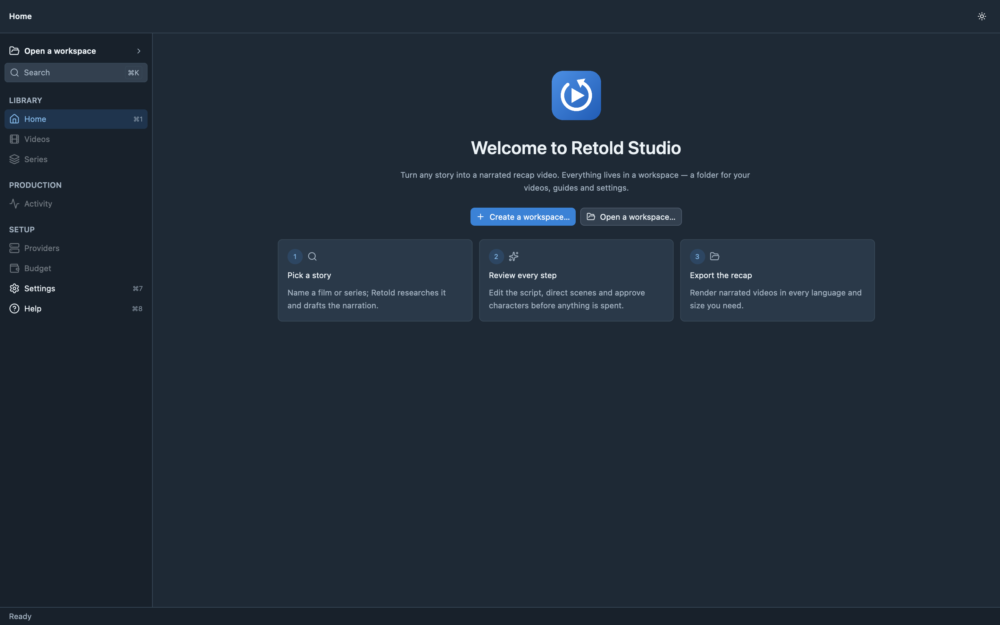
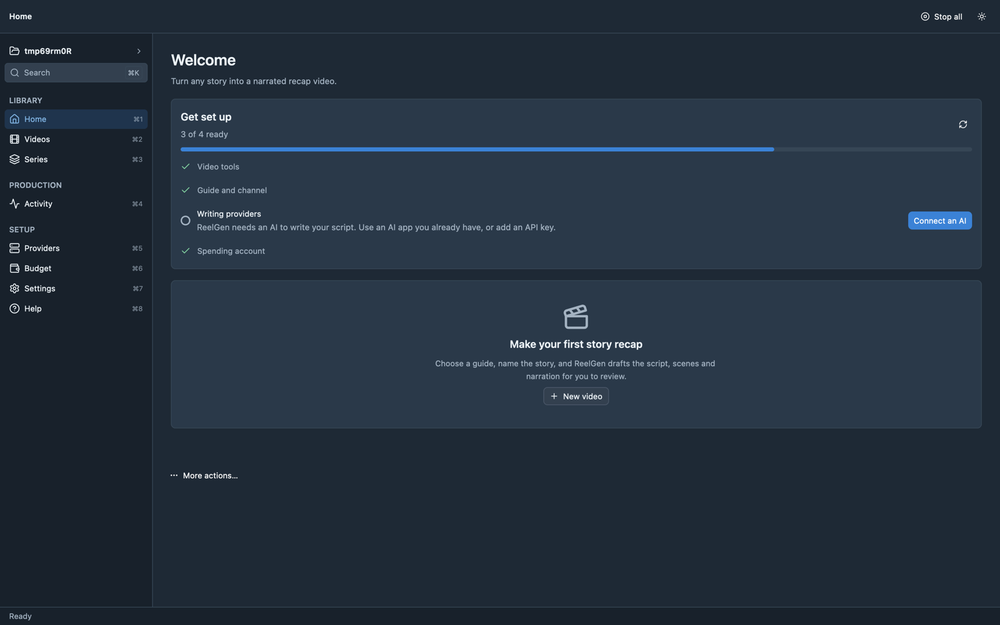
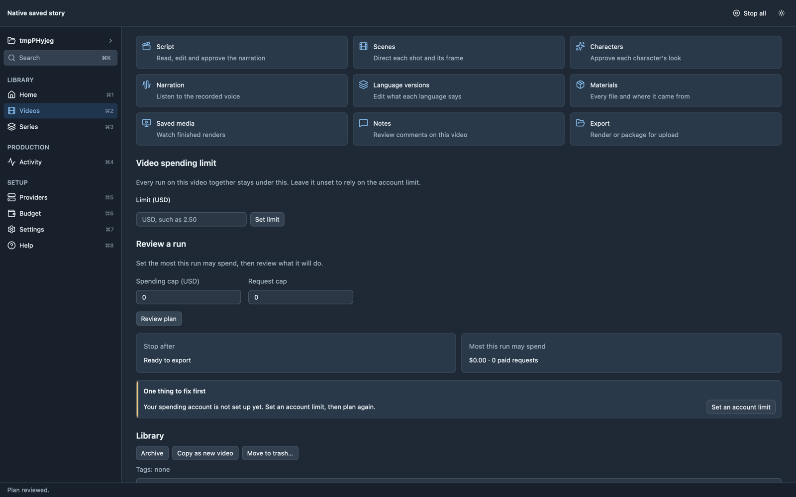
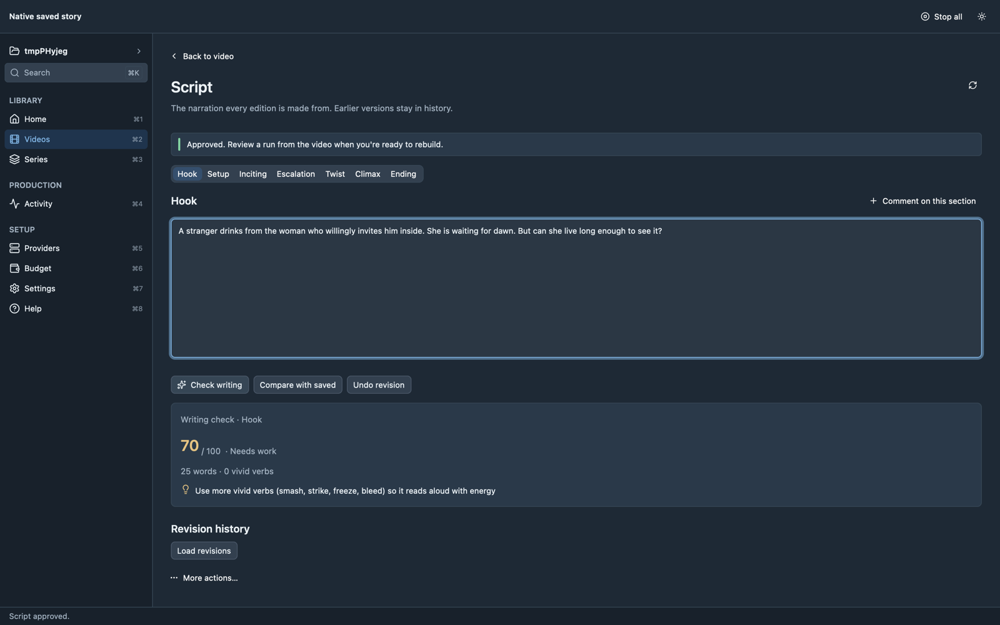

<p align="center"></p>

<h1 align="center">Retold</h1>

**Turn any story into a narrated recap video.** Retold researches a film or series, drafts
the narration, directs every scene, voices it in the languages you choose, and renders videos
ready to upload — with you reviewing and approving each step and a hard spending limit on
everything paid.



It comes in two forms that share one engine:

- **Retold Studio** — a native desktop app (macOS, Linux, Windows) built with GPUI.
- **`retold`** — the command-line tool, for scripting and automation.

## Download

Grab the installer for your platform from the
[latest release](../../releases/latest):

| Platform | Installer |
|---|---|
| macOS (Apple silicon and Intel) | `Retold-Studio-<version>-macos-<arch>.dmg` |
| Linux (Debian/Ubuntu) | `retold-studio_<version>_amd64.deb` or the `.tar.gz` |
| Windows 10 and newer | `Retold-Studio-<version>-windows-x64-setup.exe` |

The macOS build is not notarized. On first launch, right-click the app and choose **Open**.

**Requirements:** [FFmpeg](https://ffmpeg.org/) (`ffmpeg`, `ffprobe`, `ffplay`) on your `PATH`,
and at least one AI provider for writing — an AI app you already use on your computer
(such as the Claude or Codex CLI) or an API key.

## First run

1. **Create a workspace** — a folder that holds your videos, guides and settings.
2. **Get set up** — Home shows a short checklist: video tools, a guide and channel (an example
   is included), a writing provider, and a spending limit. Each step has a button that fixes it.
3. **New video** — name the story; Retold drafts the script, scenes and narration for review.
4. **Review** — edit and approve the script, scenes and characters, then review a run plan that
   shows exactly what it may spend.
5. **Export** — render each language and size you need.

| Setup checklist | A video | Script with writing check |
|---|---|---|
|  |  |  |

## Build from source

Rust 1.99 (pinned in `rust-toolchain.toml`). On Linux, install the GPUI system libraries first:

```sh
sudo apt-get install pkg-config libxkbcommon-dev libxkbcommon-x11-dev libwayland-dev \
  libvulkan-dev libx11-dev libx11-xcb-dev libxcb1-dev libfontconfig-dev libfreetype-dev \
  libasound2-dev libssl-dev libzstd-dev clang cmake
```

```sh
# Desktop app
cargo run --release --manifest-path experiments/retold-desktop/Cargo.toml --bin retold-studio
# Installer for the current platform, written to dist/
scripts/package.sh
```

## Command-line tool

From this checkout:

```sh
cargo install --path crates/retold-cli --locked --force
retold --help
```

Or run it without installing: `cargo run -p retold-cli -- --help`.

## Set up a workspace

```sh
retold workspace init ./workspace
retold --workspace ./workspace setup
retold --workspace ./workspace doctor
```

Use `--workspace PATH` to select a workspace explicitly. Guides, channels, provider definitions,
account limits, and saved production state belong to your installation and workspace.
Setup does not grant provider spending or export permission.

## Create, inspect, and continue

```sh
retold --workspace ./workspace guides --help
retold --workspace ./workspace channels --help
retold --workspace ./workspace providers --help
retold --workspace ./workspace new --help
retold --workspace ./workspace video list
retold --workspace ./workspace video plan VIDEO
retold --workspace ./workspace video continue VIDEO --until ready --yes
retold --workspace ./workspace video review VIDEO
```

Create a draft using your installed guide and channel. `new` does not dispatch providers.
Inspect the saved plan before continuing. Account initialization and configured limits are
required for execution; use `account --help` and `video continue --help` for explicit allowances.
`--yes` acknowledges a plan and does not independently authorize paid calls or export.

## Export separately

```sh
retold --workspace ./workspace video export --help
```

Choose the video, edition, and format explicitly. Continuing to `ready` does not export a video.
Existing financial evidence and execution authority remain subject to validation.

## Other commands

- `studio` and `queue`: background execution and job control.
- `spend` and `account`: resource accounting, limits, and reconciliation.
- `storage`: backup, verification, restore, and activation.
- `series`, `library`, and `creative`: series, assets, and creative inspection tools.
- `completions` and `man`: generate shell completion and a current manual.
- `--json`: machine-readable terminal results; `--plain`: noninteractive text output.

Bare invocation in an interactive terminal opens the full-screen interface. Run `retold --help`
for the complete command list and each command's `--help` for supported arguments.

In the TUI, use `1`–`9` and `0` to switch sections, `:` or `Ctrl-K` to search commands,
and `?` for help. `Tab` switches tabs, `n` creates an item in a collection, and `.` opens
actions for the selected item. Forms show field help and the equivalent CLI command;
changes require confirmation. Cancel a confirmation to return to your filled form.
`T` cycles dark, light, high contrast, and no-colour themes. Layouts support terminals
from 80×24 upward. Commands without a dedicated screen use generated forms.
See [terminal controls and supported workflows](docs/tui.md) for editing, money, review,
queue, series, and terminal integration details.

A series opened in the TUI (from the snapshot test `readme_series_capture`):

```text
 ◆ Retold   The Whole Plot
                     │ Home › Series › Show
▌ ⌂  Home        1   │╭ Series · Enter video · n draft · l link · p plan · r run · a add ──────────╮
  +  Create      2   ││ Story · budget $0.00 · ▱▱▱▱▱▱▱▱▱▱▱▱▱▱ 0/2 parts complete                   │
  ▶  Videos      3   ││                                                                            │
  ≡  Series      4   ││ P01 · One · unfinished · video-one                                         │
  ◎  Studio      5   ││   ✓ research ! script · voice   ✓ cached · ! repair · · not run            │
  ♪  Library     6   ││ P02 · Two · unfinished · no video yet                                      │
  ⇄  Providers   7   ││   No video linked · n creates a draft · l links an existing video          │
  $  Money       8   │╰────────────────────────────────────────────────────────────────────────────╯
 ↑↓ part  ⏎ video  p plan  n draft  l link  r run part  a add parts  esc back
 $ retold series show story
```

To edit provider fallbacks, press `7`, switch to **Routes** with `Tab`, and open a task
with `Enter`. Use `J`/`K` to reorder entries, `+` to add, and `-` to remove. While adding,
`Tab` cycles compatible providers; type the selector after `:` and press `Enter` to add it.
`Enter` on the chain opens confirmation; `Esc` discards the draft. A route needs at least
one entry. Configuration changes do not test or invoke providers.

The **Providers**, **Health** and **Login** tabs show recorded health, UTC check and retry
times, and offline login evidence. From a provider row, `l` opens the full status page;
`c` configures its login and `t` opens a test plan with a $0 allowance. Status refreshes
in the background. An unchecked provider is shown as unchecked.

The **Discover** tab lists supported programs found on PATH, Claude/Codex profile folders,
and OpenRouter key-variable presence. Select a discovery and press `Enter` to review an
editable provider definition. Choose any required model selectors or model files before
saving. Cancellation leaves configuration unchanged; saving preserves existing providers
and routes. Discovery does not run programs or check authentication.

## CLI cutover

The retired `make`, `resume`, `wizard`, `models`, and `bench` command interface is no longer
shipped. Create drafts with `new`, inspect them with `video plan`, then use `video continue`
and the separate `video export` command. There are no compatibility adapters for old flags.
The cutover does not move or delete user workspaces, saved runs, configuration, or model caches.
The `retold-next` alias accepts the same current commands as `retold`.

Older phase documents are historical.
[Authoring format](docs/authoring.md) describes guide/channel data; its legacy execution examples
are superseded by the commands here. [Implementation handoff](docs/implementation-handoff.md)
records implementation milestones.

## Development

```sh
./scripts/check.sh --fast
./scripts/check.sh
```

The full gate checks formatting, Clippy, the Clean Code ratchet, dependency architecture,
unused dependencies, advisories/licenses, documentation, and workspace tests.
Opt-in acceptance suites are compiled by the gate; live provider/media acceptance is separate.

## License

MIT — see [LICENSE](LICENSE).
