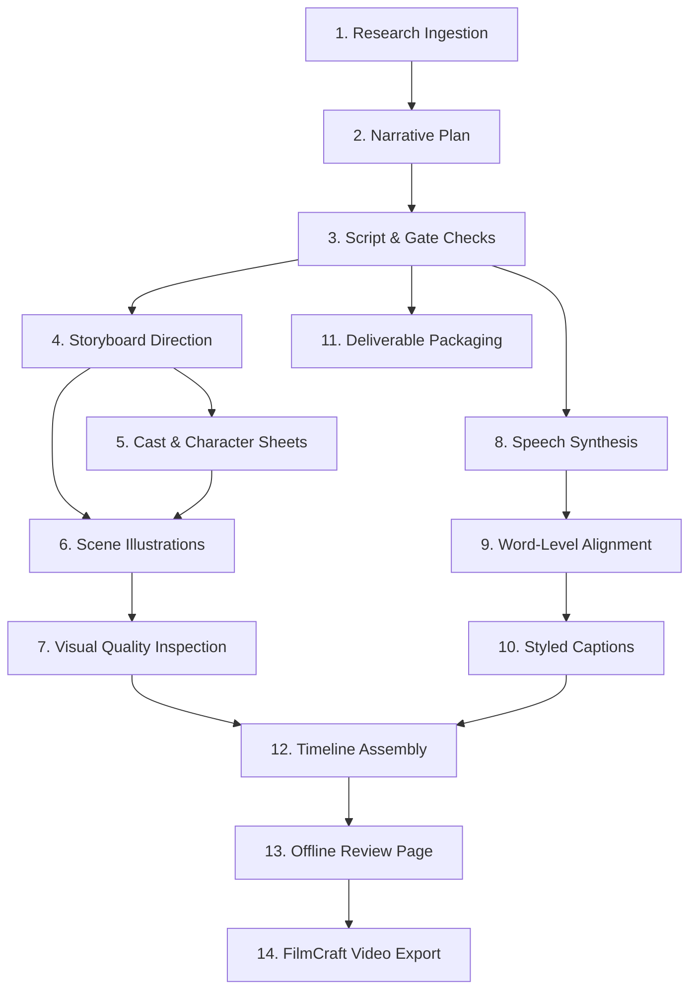

# Retold Architecture & Build Plan

**Scope: original architecture baseline, not the current rewrite acceptance contract.**
For intended rebuilt behavior, read `plan-cli.md`, `cli-product-spec.md`, `cost-quality-contract.md`,
`runtime-editing-contract.md` and `production-stage-contract.md`. Their bounded quality-qualified
routing, every-call resource authority, contextual speech units, evidence-to-depiction and explicit
export rules supersede historical subscription-first/whole-track/paid-only assumptions below.
This baseline does not claim that the newly specified rewrite is implemented.

## 1. Overview

Retold is a guide-driven, command-line video production studio written in Rust. It automates the multi-stage process of transforming factual research into structured narration, illustrated storyboards, continuous speech, timed word-level captions, and assembled video edits.

Production rules, visual styles, and narrative structures are defined entirely by user-authored **Guides** and **Channels**. Retold provides an extensible, domain-agnostic engine designed for deterministic execution, offline verification, durable state recovery, and granular spend control.

---

## 2. Core Architectural Pillars

### 2.1 Guide-Driven Extensibility
All production decisions are governed by user-authored guide packages (`guide.toml` + Markdown files):
- **Inputs:** Dynamic CLI flags and interactive prompts generated from `[inputs]`.
- **Formatting:** Aspect ratios, target durations, resolutions, and frame rates.
- **Narrative Structure:** Section allocations, pacing, and storytelling rules.
- **Writing Gates:** Deterministic validation (e.g. sentence variety, phrase constraints).
- **Visuals:** Units per second, camera shot vocabularies, and style prompt templates.
- **Packaging:** Platform-specific post metadata rules and notice templates.

### 2.2 Brand Channel Decoupling
Visual identity and voice casting are separated from content guides:
- Channel brand names, handles, and color palettes.
- Font families, styles, and typographic styling.
- Language-specific voice configurations (provider, model, voice name, instructions).
- Sandboxed reference artwork (`assets/style.png`).

### 2.3 Provider Abstraction & Subscription-First Routing
Retold models AI execution through an abstract provider router:
- Prioritizes subscription CLI tools (Claude Code CLI, Codex CLI, Gemini CLI) for zero-marginal-cost text and vision tasks.
- Routes media synthesis (images, continuous speech, transcription) through configurable API providers (e.g. OpenRouter, local Whisper).
- Supports offline mock providers for automated regression testing.

### 2.4 Durable Execution Graph
- **Step Hash Identity:** Every pipeline stage computes a deterministic hash of inputs, code revision, and dependencies.
- **Atomic Commits:** Results are written to disk with atomic renames and registered in an SQLite/JSON store.
- **Recovery & Resumption:** Any interrupted run resumes from its last committed checkpoint without duplicating work or re-dispatching completed requests.
- **Selective Redo:** Targeted invalidation of individual frames or stages recalculates only affected downstream artifacts.

### 2.5 Controlled Spending Ledger
- Every billable request records a pre-dispatch conservative ceiling reservation in `.retold/ledger.json`.
- Holds persist across crashes until receipt settlement or explicit reconciliation.
- Strict per-run cumulative budgets block unauthorized overages.

---

## 3. Pipeline Stages

1. **Research Ingestion:** Loads facts from local documents (`--source-file`) or configured sources.
2. **Narrative Plan:** Outlines story beats matching the guide's section requirements.
3. **Script & Writing Gates:** Generates hook candidates, selects drafts, and verifies writing constraints.
4. **Storyboard Direction:** Splits narration into timed visual units with shot selections and action notes.
5. **Cast & Character Sheets:** Generates multi-angle reference turnarounds when characters are enabled.
6. **Scene Illustrations:** Synthesizes scene frames conditioned on style and character references.
7. **Visual Quality Inspection:** Detects unwanted text, anatomy defects, safe-zone violations, and off-model drift.
8. **Speech Synthesis:** Generates continuous, natural narration audio.
9. **Word-Level Alignment:** Transcribes audio to align every word with millisecond timestamps.
10. **Styled Captions:** Packs subtitles into balanced reading groups with font-shaped word highlighting.
11. **Deliverable Packaging:** Generates platform-compliant post titles, descriptions, and hashtags.
12. **Timeline Assembly:** Compiles camera pans, zooms, audio ducking envelopes, and video cuts into timeline JSON.
13. **Offline Review Page:** Generates a local, self-contained HTML review bundle.
14. **FilmCraft Video Export:** When explicitly authorized (`--allow-video`), coordinates rendering via FilmCraft.

---

## 4. Multi-Language Architecture

Retold supports generating localized video editions from a single production run:
- **Transcreation:** Adapts master scripts into target languages while adhering to language-specific duration windows.
- **Shared Visuals:** Localized editions reuse rendered scene artwork, significantly reducing compute costs.
- **Script Validation:** Enforces native alphabet coverage and detects untransliterated loanwords.
- **Independent Audio Tracks:** Synthesizes and aligns speech per language take.
